<a href="https://yab.pro.et"><picture><source media="(prefers-color-scheme: dark) and (max-width: 600px)" srcset="assets/hero-phone-dark.svg"><source media="(max-width: 600px)" srcset="assets/hero-phone-light.svg"><source media="(prefers-color-scheme: dark)" srcset="assets/hero-dark.svg"></picture></a>

<a href="https://yab.pro.et"><picture><source media="(prefers-color-scheme: dark)" srcset="assets/link-site-dark.svg"></picture></a>
<a href="https://www.linkedin.com/in/itsyaba/"><picture><source media="(prefers-color-scheme: dark)" srcset="assets/link-linkedin-dark.svg"></picture></a>
<a href="https://t.me/itsyaba"><picture><source media="(prefers-color-scheme: dark)" srcset="assets/link-telegram-dark.svg"></picture></a>
<a href="https://x.com/itsyabah"><picture><source media="(prefers-color-scheme: dark)" srcset="assets/link-x-dark.svg"></picture></a>
<a href="mailto:yabahane@gmail.com"><picture><source media="(prefers-color-scheme: dark)" srcset="assets/link-mail-dark.svg"></picture></a>

<picture><source media="(prefers-color-scheme: dark) and (max-width: 600px)" srcset="assets/stats-phone-dark.svg"><source media="(max-width: 600px)" srcset="assets/stats-phone-light.svg"><source media="(prefers-color-scheme: dark)" srcset="assets/stats-dark.svg"></picture>

<picture><source media="(prefers-color-scheme: dark) and (max-width: 600px)" srcset="assets/year-phone-dark.svg"><source media="(max-width: 600px)" srcset="assets/year-phone-light.svg"><source media="(prefers-color-scheme: dark)" srcset="assets/year-dark.svg"></picture>

<h3>Things I've made</h3>

<a href="https://github.com/itsyaba/melodify"><picture><source media="(prefers-color-scheme: dark) and (max-width: 600px)" srcset="assets/app-melodify-phone-dark.svg"><source media="(max-width: 600px)" srcset="assets/app-melodify-phone-light.svg"><source media="(prefers-color-scheme: dark)" srcset="assets/app-melodify-dark.svg"></picture></a>
<a href="https://patchwork-editor.vercel.app"><picture><source media="(prefers-color-scheme: dark) and (max-width: 600px)" srcset="assets/app-patchwork-phone-dark.svg"><source media="(max-width: 600px)" srcset="assets/app-patchwork-phone-light.svg"><source media="(prefers-color-scheme: dark)" srcset="assets/app-patchwork-dark.svg"></picture></a>

<a href="https://melon-jelly-tau.vercel.app"><picture><source media="(prefers-color-scheme: dark) and (max-width: 600px)" srcset="assets/app-melon-jelly-phone-dark.svg"><source media="(max-width: 600px)" srcset="assets/app-melon-jelly-phone-light.svg"><source media="(prefers-color-scheme: dark)" srcset="assets/app-melon-jelly-dark.svg"></picture></a>
<a href="https://github.com/itsyaba/forge"><picture><source media="(prefers-color-scheme: dark) and (max-width: 600px)" srcset="assets/app-forge-phone-dark.svg"><source media="(max-width: 600px)" srcset="assets/app-forge-phone-light.svg"><source media="(prefers-color-scheme: dark)" srcset="assets/app-forge-dark.svg"></picture></a>

<a href="https://github.com/itsyaba/Leash"><picture><source media="(prefers-color-scheme: dark) and (max-width: 600px)" srcset="assets/app-leash-phone-dark.svg"><source media="(max-width: 600px)" srcset="assets/app-leash-phone-light.svg"><source media="(prefers-color-scheme: dark)" srcset="assets/app-leash-dark.svg"></picture></a>
<a href="https://github.com/itsyaba/redactenv"><picture><source media="(prefers-color-scheme: dark) and (max-width: 600px)" srcset="assets/app-redactenv-phone-dark.svg"><source media="(max-width: 600px)" srcset="assets/app-redactenv-phone-light.svg"><source media="(prefers-color-scheme: dark)" srcset="assets/app-redactenv-dark.svg"></picture></a>

<a href="https://github.com/itsyaba/redat"><picture><source media="(prefers-color-scheme: dark) and (max-width: 600px)" srcset="assets/app-redat-phone-dark.svg"><source media="(max-width: 600px)" srcset="assets/app-redat-phone-light.svg"><source media="(prefers-color-scheme: dark)" srcset="assets/app-redat-dark.svg"></picture></a>
<a href="https://github.com/itsyaba/dotfiles"><picture><source media="(prefers-color-scheme: dark) and (max-width: 600px)" srcset="assets/app-dotfiles-phone-dark.svg"><source media="(max-width: 600px)" srcset="assets/app-dotfiles-phone-light.svg"><source media="(prefers-color-scheme: dark)" srcset="assets/app-dotfiles-dark.svg"></picture></a>

<h3>Open source</h3>

- **[Mangayomi](https://github.com/kodjodevf/mangayomi)**: a free reader for manga, novels and anime on Android, iOS and desktop, with 4.6k stars. [11 merged pull requests](https://github.com/kodjodevf/mangayomi/pulls?q=is%3Apr+author%3Aitsyaba+is%3Amerged) in the app (smoother webtoon scrolling, backup restore, update badges, extension installs) and [9 in its extensions](https://github.com/m2k3a/mangayomi-extensions/pulls?q=is%3Apr+author%3Aitsyaba+is%3Amerged), mostly new sources.
- **[data-peek](https://github.com/Rohithgilla12/data-peek)**: a fast, minimal desktop database client. [Made its desktop menu items that did nothing actually work](https://github.com/Rohithgilla12/data-peek/pull/289).
- **In review:** [Expo Router](https://github.com/expo/expo/pull/51242) (an extra render in `useFocusEffect`), [shadcn/ui](https://github.com/shadcn-ui/ui/pull/12240) (registry hooks landing in the right workspace) and the [Caelestia shell](https://github.com/caelestia-dots/shell/pull/2110) (an option to turn the weather off).

  
  

Every picture here is drawn by <a href="scripts/build.mjs">scripts/build.mjs</a> and redrawn every night from my GitHub data.
