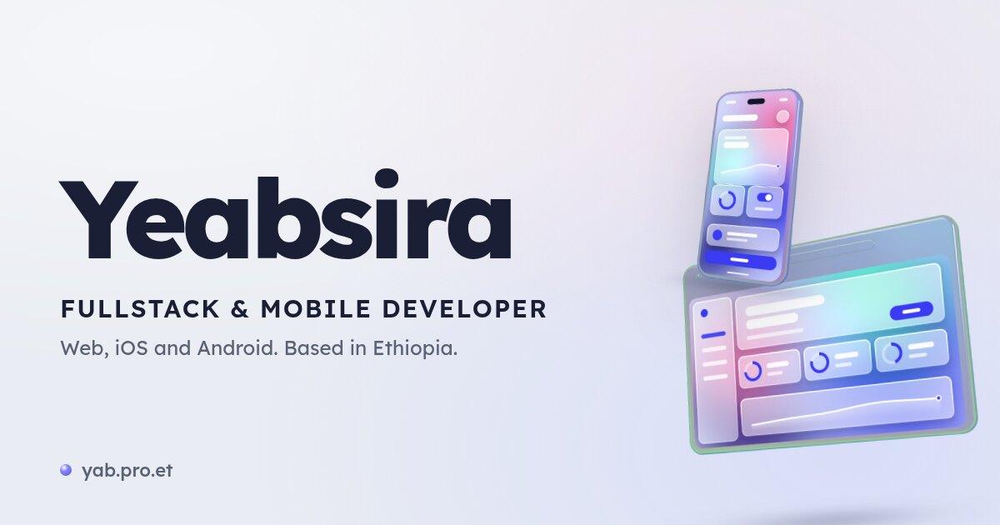

<h2>Hi 👋, I'm Yeabsira</h2>

I build products people use, from the API to the app in your pocket: web, iOS and Android, from Addis Ababa, Ethiopia.

- Frontend engineer at [IDEEZA](https://www.ideeza.com), an AI platform that turns a product idea into hardware.
- As CTO of Tigu, I built its app, website, admin and backend. The app passed 7,000 downloads in its first 75 days.
- 13 merged pull requests to [Mangayomi](https://github.com/kodjodevf/mangayomi) and its extensions, for fun.
- Everything else is on [yab.pro.et](https://yab.pro.et).

<h3>Side projects</h3>

- **[Melodify](https://github.com/itsyaba/melodify)**: an offline-first music player for iPhone and Android, inspired by Musicolet. No accounts, no streaming, no ads: it plays the files on your phone. Expo and React Native.
- **[Patchwork](https://patchwork-editor.vercel.app)**: an AI site builder where your own edits survive. Every visual tweak becomes a real code edit, and when you ask the AI for more, it builds around your work. ([code](https://github.com/itsyaba/patchwork))
- **[Melon Jelly](https://melon-jelly-tau.vercel.app)**: a slice of watermelon jelly you can pull and cut, simulated as a real soft body in WebGPU. The physics and shaders are hand-written. ([code](https://github.com/itsyaba/melon-jelly))
- **[Forge](https://github.com/itsyaba/forge)**: a workout planner for people who don't know what a workout looks like yet. It suggests a plan from your free days and walks you through every set.
- **[Leash](https://github.com/itsyaba/Leash)**: an Android app that puts addictive apps on a leash, with real time limits and cooldowns that are hard to get around.
- **[redactenv](https://github.com/itsyaba/redactenv)**: scrubs API keys, tokens and secrets out of a Node server's responses, error pages and logs before they leave the server.
- **[Redat (ረዳት)](https://github.com/itsyaba/redat)**: an Amharic voice assistant for my Linux desktop. I speak, Claude does the task, and it answers out loud in Amharic.
- **[dotfiles](https://github.com/itsyaba/dotfiles)**: my CachyOS + Hyprland setup on the Caelestia shell, with glass panels and a usage drawer I built in Quickshell.

  
  
  
  
  

<picture>
  <source media="(prefers-color-scheme: dark)" srcset="https://streak-stats.demolab.com?user=itsyaba&theme=github-dark-blue&hide_border=true&border_radius=10" />
  
</picture>

  
  

<picture>
  <source media="(prefers-color-scheme: dark)" srcset="https://raw.githubusercontent.com/itsyaba/itsyaba/output/snake-dark.svg" />
  
</picture>
